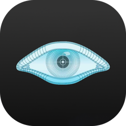
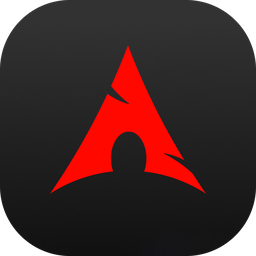

### Red Teaming | Network Penetration Testing | AD Attacks | OS Exploitation

## About Me

| Category | Details |
| :--- | :--- |
| **Focus** | Red teaming, network penetration testing, Active Directory attacks, OS exploitation |
| **Background** | 3+ years in IT, networking and infrastructure (MikroTik, VDI and virtualization) |
| **Training** | Red team track through a cybersecurity academy scholarship program |
| **Goal** | Work as an offensive security professional on a red team |
| **Location** | <!-- EDIT: your city, country --> |

## Tech Stack

  
  
  
  
  
  
  
  
  
  
  
  

## CTF and Practice Platforms

| Platform | Profile |
| :--- | :--- |
| **HackTheBox** | [profile](https://app.hackthebox.com/profile/YOUR-ID) |
| **TryHackMe** | [profile](https://tryhackme.com/p/YOUR-USERNAME) |
| **PortSwigger Web Security Academy** | [profile](https://portswigger.net/web-security) |

## Connect

  
  

All tools and research published here are intended for education and authorized security testing only.

